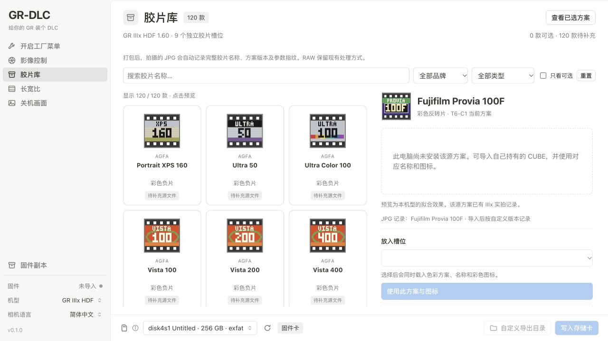

# GR-DLC

**给你的 GR 装个 DLC。**

理光 GR 的开源扩展工具箱：胶片色彩、独立影像控制槽位、自定义画幅与关机图片。

[English](README.en.md) · [下载 / Releases](https://github.com/Mrjie7205/GR-DLC/releases) · [反馈问题](https://github.com/Mrjie7205/GR-DLC/issues) · [来源与致谢](CREDITS.md) · [GPL-2.0-only](LICENSE)

GR-DLC 是基于 [Maxwooow/Ricoh-GRMod](https://github.com/Maxwooow/Ricoh-GRMod) 及下列社区项目继续开发的**独立维护衍生项目**。保留上游提交历史与版权声明，由 Mrjie7205 维护；不代表理光或上游项目。首个独立版本 **0.1.0** 承接此前 GR Mod `0.6.4-film120-jpg-w2` 的功能。



## 可以做什么

- **九个独立胶片槽位**：自定义名称与彩色图标，保留原厂影像控制；GR IV 的两个 Cinema 槽位也保留。
- **120 款胶片目录与包装风格图标**：按型号检索、查看来源，导入自己的 sRGB `.cube`，每份固件最多选九款。
- **九画幅与完整 RAW**：IIIx HDF 保留现有 T4 画幅处理，JPG 与预览跟随画幅，RAW 保留完整 6000×4000。
- **JPG 配方记录**：IIIx HDF 在 EXIF UserComment 写入胶片全名、方案版本和实际参数指纹，检查照片时不必依赖拍摄顺序。
- **自定义关机图片**：IIIx HDF 的 W2 图片随正常固件导出；选择原厂画面即可恢复默认图片。
- **按机型提供扩展功能**：IIIx 的清晰度柔焦，以及 GR IV 已有的 ADJ 柔焦、日期印记和黑白影调扩展。

色彩方案由相机的矩阵与 RGB 曲线近似实现，不等同于在相机内完整运行 3D LUT，也不包含空间颗粒或光晕。

## 支持范围与实测状态

| 项目 | GR IIIx HDF · 1.60 | GR IV / GR IV HDF · 1.11 |
| --- | --- | --- |
| 九独立胶片槽位、保留原厂方案 | 有实机反馈 | 软件及原生函数检查通过，待实机 |
| 自定义画幅与 RAW | T4 宽幅频闪修复获实机确认；完整 RAW 有样片核对 | 保留已有处理；本次九槽位组合待实机 |
| JPG 名称／版本／指纹 | 有样片核对 | 尚未移植 |
| W2 内嵌关机图片 | 显示与清晰度获实机确认 | 尚未移植；沿用原有图片方式 |
| 柔焦等扩展 | 清晰度 −1／−2／−3；无独立 ADJ 柔焦项 | 沿用上游 ADJ 柔焦、日期印记、黑白影调 |

实机反馈覆盖部分胶片与设置，**不代表 120 款方案和所有画幅组合都经过相机测试**。其他机型或固件版本不在本次适配范围内。

## 安装与使用

1. 从 [Releases](https://github.com/Mrjie7205/GR-DLC/releases) 下载与你电脑匹配的版本。macOS 通过本地浏览器显示界面，Windows 使用 WebView2 或浏览器。
2. 选择准确机型，打开对应官方固件：IIIx HDF **1.60** 或 GR IV 系列 **1.11**。下载器提供更新的版本，并不表示它已获支持。
3. 在“胶片库”选择条目并导入自己的 CUBE，分配到最多九个槽位；按需设置画幅与关机图片。
4. 先导出到电脑检查，再按相机对应的官方更新步骤使用 SD 卡安装。保留官方固件、自己的设置和原始照片。

**公开包包含 120 款目录、图标及导入／转换能力，不捆绑第三方 LUT、转换参数或理光固件。** 未安装的条目显示待导入。开发者本地研究库曾准备 119 款输入，Velvia 100F 仍待导入；这不是公开包内置 119 款配方的承诺。[catalog.json](ui/public/film-library/catalog.json) 记录逐项来源。

首个独立版本作为预览版发布。修改固件存在风险，请核对机型、版本及验证范围；详见 [使用与恢复说明](docs/GRMOD_INTEGRATION.txt)、[IIIx 验证记录](docs/GR3X_HDF.md)。本软件没有厂商保修承诺。macOS 应用采用临时签名，尚未经过 Apple 公证。

### 从 GR Mod 迁移

GR-DLC 使用独立数据目录，不会自动改写 GR Mod 配置。关闭两款应用后，可以先备份，再将旧目录中的 `store/` 复制到新目录。目录内可能含官方固件或私人图片，请仅在自己的电脑上迁移。

| 平台 | GR-DLC 数据目录 |
| --- | --- |
| macOS | `~/Library/Application Support/GR-DLC` |
| Windows | `%LOCALAPPDATA%\GR-DLC` |
| Linux 开发模式 | `$XDG_DATA_HOME/gr-dlc`，或 `~/.local/share/gr-dlc` |

工程文件、旧固件识别标记和内部接口保持兼容。历史资料中的 GR Mod、T4、T6、J1、W2 名称保留，便于对应此前的实测记录。

## 基于哪些项目

| 来源 | 继承或参考的内容 |
| --- | --- |
| [Maxwooow/Ricoh-GRMod](https://github.com/Maxwooow/Ricoh-GRMod) | 直接代码基础：桌面界面、固件容器与校验、色彩转换、GR IV 功能、文件与 SD 卡操作 |
| [DoYitNow/gr-custom-tool](https://github.com/DoYitNow/gr-custom-tool) | 自定义画幅编译器、原生裁切代码与参考验证；IIIx 移植继续建立在这些工作之上 |
| [radium-wang/ricoh-gr4-firmware-analysis-and-feature-expansion](https://github.com/radium-wang/ricoh-gr4-firmware-analysis-and-feature-expansion) | GR IV 固件及关机画面机制的公开研究；IIIx W2 为后续适配 |
| [lemonadesaltbagel/GR4-MonoUnlock](https://github.com/lemonadesaltbagel/GR4-MonoUnlock) | GR IV Monochrome 影调解锁方法；继承实现说明为方法参考、未复制其代码 |
| [t3mujinpack](https://github.com/t3mujinpack/t3mujinpack) · [G'MIC Color Presets](https://gmic.eu/color_presets/) | 胶片目录及本地研究库的 Hald／色彩来源 |
| [Spectral Film LUT](https://github.com/JanLohse/spectral_film_lut) · [Redlamp](https://github.com/pdcgomes/redlamp) | 光谱胶片模型与色彩模型的 sRGB 适配研究 |
| [Moderate Film Simulator](https://github.com/Moder4te/moderates-film-simulator) · [PictureFX / Marc Roovers](https://marcrphoto.wordpress.com/2025/02/28/picturefx-cinestill-800t-v2-0-lut/) | 部分胶片模型及 CineStill 方案的本地研究来源，各自授权独立适用 |

完整版本、许可、代码与研究关系见 [CREDITS.md](CREDITS.md)。列出来源不代表这些作者维护或背书 GR-DLC。

在这些基础上，本分支完成 IIIx HDF 1.60 适配、宽幅拍后显示修复、完整 RAW 保留、两款机型九独立胶片槽位、120 款目录与图标、JPG 配方身份、W2 图片导出和 macOS 集成。相关提交与测试记录均保留。

## 从源码构建

需要 Node.js 22+ 和 Go 1.24+。普通构建不会下载第三方胶片或固件。

```sh
git clone https://github.com/Mrjie7205/GR-DLC.git
cd GR-DLC
npm ci
npm run build
cd shell
./build.sh macos     # macOS：dist/GR-DLC.app
# ./build.sh windows # Windows x64：dist/GR-DLC.exe
# ./build.sh dev     # Linux 开发模式：dist/gr-dlc-dev
```

Windows 资源生成工具：`go install github.com/tc-hib/go-winres@v0.3.3`。macOS 打包需要在 macOS 上运行。

```sh
npm test
npm -w core run typecheck
cd shell
go test ./...
```

需要官方固件或私人样本的测试在缺少输入时跳过。可通过 `GRMOD_GR3X_FIRMWARE`、`GRMOD_GR4_FIRMWARE`、`GRMOD_GR3X_W2` 指定自己持有的文件。详见 [测试指南](docs/GR3X_HDF.md) 与 [技术背景](docs/TECHNICAL_BACKGROUND.md)。

## 参与与许可

欢迎 Star、Fork、提交可复现的问题或改进。反馈请注明机型、固件版本、使用功能和 JPG／RAW 设置；请勿上传完整固件或无权再分发的 LUT。见 [贡献说明](CONTRIBUTING.md)。

代码沿用 **GPL-2.0-only**，保留各文件原有声明。发布程序时提供对应完整源码与构建说明。第三方胶片、图片、字体等资源按各自许可处理，不因列在目录中就转为 GPL。RICOH、GR 及胶片产品名称归各自权利人所有。

独立项目整理日期：2026-10-15。参见 [更新记录](CHANGELOG.md)。
